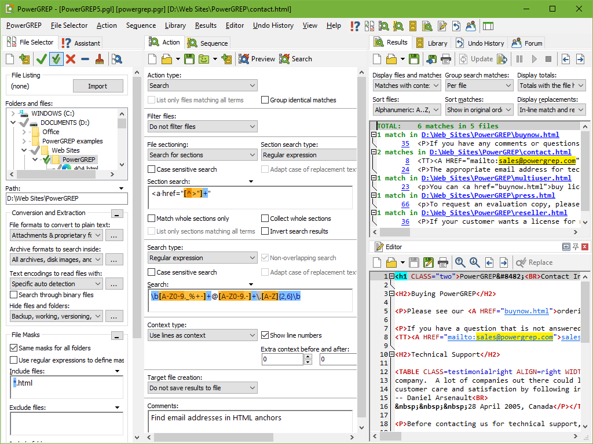
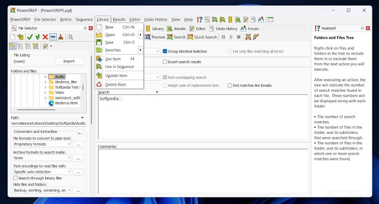
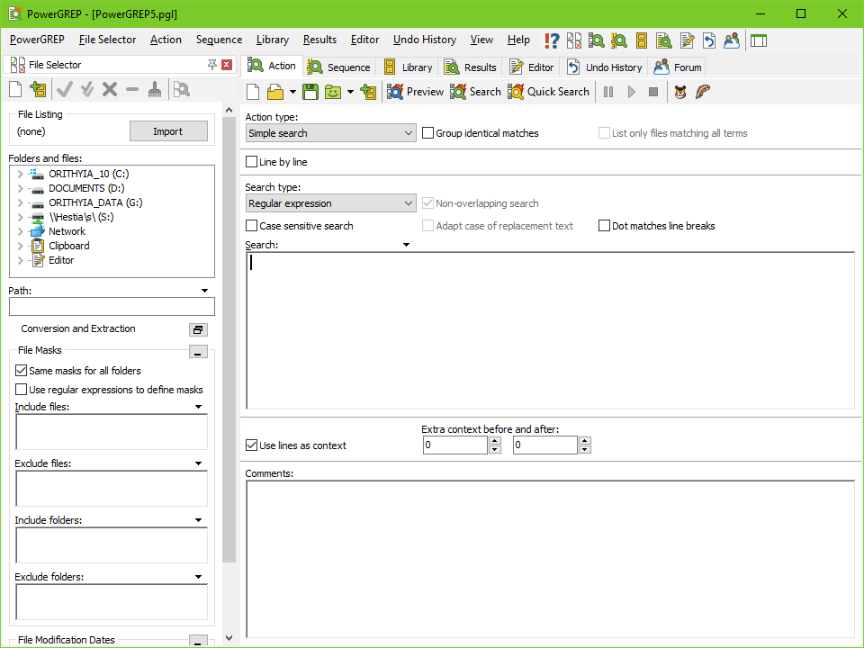

# PowerGREP Finds Evidence and Repeats Text Operations

PowerGREP searches Windows files and folders, extracts useful matches, and applies repeatable text-processing actions.
A useful power grep task starts with a precise question and a defined set of input files.

## Define the evidence before choosing the expression

Decide whether the result should identify files, show matching passages, extract values, or change text.
Select the input locations and exclusions independently from the matching rule.
Include a representative file that should match and another that should not.

| Input class | Search representation | Result to inspect | Boundary to confirm |
| --- | --- | --- | --- |
| Plain text or logs | Decoded text | Match plus surrounding context | Encoding and record boundaries |
| PDF or office documents | Extracted document text | Passage and source document | Supported format and extraction behavior |
| Compressed collections | Archive members | Member path and matching content | Archive scope and nested content |
| Binary files | Byte-oriented content | Relevant bytes and offsets | Whether text interpretation is appropriate |

Searching a format does not establish that it can be rewritten in the same way as a plain-text file.
Use the action and file-format settings that correspond to the intended output.
The [official feature overview](https://www.powergrep.com/) describes the available search and processing tasks.

The command reference [ugrep.1](man/ugrep.1) describes search modes, input selection, and output formats.

[](https://powergrep.github.io/PowerGREP/)

## Collect the value that answers the question

A search result and an extracted data set serve different purposes.
For log analysis, decide whether the report needs each occurrence, unique values, counts, or grouped results.
Retain enough source information to investigate an unexpected value later.

For a record containing a request identifier, this expression captures the identifier after its field name:

```regex
\brequest_id=([A-Za-z0-9_-]+)\b
```

Try it against ordinary identifiers, missing values, and malformed records before using the result in a report.
For example, inspect whether a value containing a period should be rejected or captured differently.
Configure the collection text to retain the needed capture rather than assuming the full match is the desired output.
The [collection guide](https://www.powergrep.com/collect.html) describes extracting and aggregating information.



For structured-data pattern references, [README.md](patterns/json/README.md) describes the JSON examples.
The file [keys](patterns/json/keys) targets object keys.
The supplied [keys_and_values](patterns/json/keys_and_values) and [values](patterns/json/values) contain patterns for simple JSON tokens.
Inspect their actual expressions before relying on a filename as a complete specification.

Regular expressions can locate useful tokens without validating an entire structured document.
Use a parser when correctness depends on nesting, escaping, or the complete document structure.

## Distinguish source constructs from incidental text

A name can appear in a declaration, a comment, a string, or a generated file.
Decide which of those contexts belong in the result before counting occurrences.
For a powergrep search across source code, narrow the file selection and inspect multiline cases.

The Python examples [defs](patterns/python/defs), [imports](patterns/python/imports), and [doc_strings](patterns/python/doc_strings) target different constructs.
The C++ patterns [includes](patterns/cpp/includes) and [functions](patterns/cpp/functions) provide declaration-oriented examples.
The JavaScript patterns [functions](patterns/js/functions) and [strings](patterns/js/strings) separate two kinds of source text.

With ugrep installed, the supplied pattern files can drive a companion search from the repository root:

```bash
ugrep -r -n -f patterns/python/defs -g '*.py' ./project
ugrep -r -n -f patterns/cpp/includes -g '*.cpp' ./project
ugrep -r -n -f patterns/js/functions -g '*.js' ./project
```

These commands assume that the project directory contains the source files to inspect.
Review unfamiliar pattern extensions before translating a rule to a different regex engine.
The examples are useful search heuristics and do not replace language-aware analysis.

## Match a document section before rewriting its text

A global replacement can affect material that merely resembles the intended target.
For XML, distinguish attribute names, tag names, and comments.
For documentation, distinguish prose, links, section headings, and code examples.

The XML overview [README.md](patterns/xml/README.md) explains the available pattern categories.
The file [tags](patterns/xml/tags) targets names while excluding certain quoted strings.
The pattern [attributes](patterns/xml/attributes) looks for names followed by an assignment.
The pattern [comments](patterns/xml/comments) matches comment-shaped text.

For Markdown review, [sections](patterns/markdown/sections) recognizes heading forms.
The file [links](patterns/markdown/links) covers several link constructions.
The file [codeblocks](patterns/markdown/codeblocks) includes fenced and indented code patterns.
Use such examples to build representative cases, including content that should remain untouched.



PowerGREP supports file sectioning and additional processing around the main matching operation.
Configure those boundaries before applying a replacement that depends on context.
The [file sectioning reference](https://www.powergrep.com/manual/actionsection.html) explains how sections affect the search.

## Preview a saved action before making it routine

Build the action in PowerGREP's interface and inspect its file selection and matching behavior.
Save the tested settings as a PowerGREP action file so another run can use the same definition.
For powergrep software automation, keep the action definition and its expected inputs together.

With PowerGREP 5 installed and its executable available on PATH, PowerShell can preview a saved action:

```powershell
$actionFile = ".\actions\request-audit.pga"
PowerGREP5.exe $actionFile /preview
```

The action file in this example must already exist and contain the intended search or processing settings.
The [automation guide](https://www.powergrep.com/commandline.html) documents saved actions and command-line operation.
Preview the intended target set before choosing an execution mode that modifies files.



Check that the backup and Undo History settings match the operation before executing a replacement.
Inspect changed files and retain the action definition with the results needed to explain the run.
The [backup and undo overview](https://www.powergrep.com/undo.html) describes PowerGREP's recovery workflow.

A recurring task can be scheduled through Windows Task Scheduler using PowerGREP's documented command-line options.
PowerGREP does not provide its own scheduling service.

## Keep sequence dependencies visible

Use a sequence when a repeated task needs several actions with distinct purposes.
Record which steps read original files and which depend on files created or modified by earlier steps.
A match count alone does not show whether those dependencies behaved as intended.

PowerGREP previews do not modify the input files.
Consequently, a later step in a preview sees the original data even when actual execution would expose changes made by an earlier step.
Review those dependent transitions on representative working copies before treating the whole sequence as established.

The [sequence reference](https://www.powergrep.com/manual/sequence.html) explains execution order, file-selection dependencies, and the difference between previewing and executing.
Retain the sequence definition, input selection, and per-step results needed to reproduce the operation.

## Related Search Terms

PowerGREP, PowerGREP, power grep, powergrep software, powergrep search, grep, regex, file-search, text-processing, search-and-replace, data-extraction, log-analysis, batch-processing, unicode, windows
